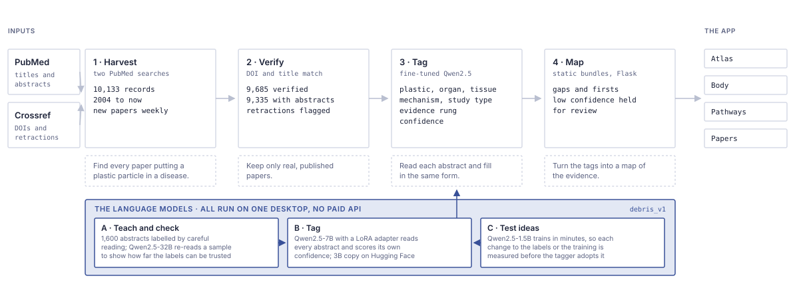

# 🧪 DEBRIS

> **Ten thousand papers on plastic particles and human disease, read by machine and mapped.**

        

<table>
<tr>
<td>🌐 <b>Website</b></td><td><a href="https://marcdeller.com" target="_blank" rel="noopener noreferrer">marcdeller.com</a></td>
<td>✉️ <b>Contact</b></td><td><a href="mailto:marc@marcdeller.com">marc@marcdeller.com</a></td>
<td>🐙 <b>GitHub</b></td><td><a href="https://github.com/bellcheddar/DEBRIS" target="_blank" rel="noopener noreferrer">bellcheddar/DEBRIS</a></td>
</tr>
</table>

---

Plastic particles small enough to cross from the gut or the lung into the bloodstream have
now been found in human blood, lung, placenta, artery plaque and brain. What that means for
health is being worked out in thousands of separate papers that nobody has read in full.
DEBRIS reads them. It collects every PubMed paper that puts a micro or nanoplastic particle
inside a human disease, checks that each one is a real published paper, and has a small
language model read every abstract and fill in the same short form: which plastic, which
organ and tissue, which biological mechanism, what kind of study, and how close the finding
sits to an effect in a living person. The result is a map of the evidence rather than
another reading list.

Why it matters: the question people actually ask, what do we know about plastic particles and human disease, has no single answer anywhere, because the evidence is spread across toxicology, cardiology, obstetrics and environmental science journals that rarely cite one another and is growing every week. Asking the same questions of every abstract turns that scattered literature into something a person can see at once, including the parts of it that are empty. It is useful for: finding the papers behind a claim, telling what has been shown in people apart from what has only been shown in cells, and seeing which plastic and organ combinations nobody has studied yet.

Live at [debris.mdeller.com](https://debris.mdeller.com).

## 🔧 How it works

The diagram at the top shows four stages, left to right, then the app that shows the result.

| Stage | What it does |
|---|---|
| **1 · Harvest** | Searches PubMed two ways, so papers are found whether or not they have been indexed yet |
| **2 · Verify** | Keeps a paper only if its DOI resolves at Crossref and the titles match; retractions are flagged, never deleted |
| **3 · Tag** | A fine-tuned language model reads each abstract and fills in the form, with a confidence score |
| **4 · Map** | The tags become the charts, the body map and the searchable table |

### Where the language models come in

Reading ten thousand abstracts against a fixed form is the one part of this that rules
cannot do. Abstracts say the same thing a dozen ways, and the distinction that matters most,
whether an effect was seen in a person or in a dish of cells, is carried by phrasing rather
than by any keyword. Three models share the work, and all of them run on one desktop
computer with no paid service behind them.

- **A · Teach and check.** 1,600 abstracts were labelled by careful reading to make the
  training set. A much larger model, Qwen2.5-32B, then re-reads a sample on its own. Where
  two careful readers disagree, no model trained on those labels can do better, so this
  sets an honest ceiling for every field.
- **B · Tag.** The tagger is Qwen2.5-7B with a small trained add-on (a LoRA adapter). It
  learns the form, not facts about plastics, so a wrong tag is a misreading rather than an
  invented finding. It gives the same answer for the same abstract next year, which a
  hosted service that changes underneath you does not. Each tag carries a confidence
  score, and anything it is unsure about is shown as needing review rather than published.
- **C · Test ideas.** Qwen2.5-1.5B trains in minutes, so every proposed change to the
  labels or the training is tried on it first and kept only if it measurably helps.

## What a tag records

A tag is a reading of one paper, not a verdict on the science. For each abstract it records
the plastics named, the particle size, the organs and tissues involved, the disease, the
biological mechanisms, the kind of study, and how far up the evidence ladder the paper gets.

| Rung | Meaning |
|---|---|
| 1 | Detected in human tissue or fluid |
| 2 | Associated with an outcome in a group of people |
| 3 | Reproduced in a living animal |
| 4 | Mechanism shown in cells or tissue samples |
| 5 | Effect grows with dose |
| 6 | Effect reverses when the particles are removed |

The rungs are not a ranking of journals or authors. They say how far a claim sits from a
human outcome, so a reader can see the shape of the evidence without taking anyone's word
for it. Reviews carry no rungs.

## The four tabs

- **Atlas**: which plastics have been studied together, and the evidence ladder by disease and year.
- **Body**: click an organ to see the plastics found in it, the mechanisms and the papers behind them.
- **Pathways**: how each plastic links to mechanisms and diseases.
- **Papers**: the whole verified corpus, searchable and filterable. NEW marks papers from the
  latest weekly run; NOVEL marks the first paper to link a plastic to an organ.

## 🤗 The models

| Role | Model | Where |
|---|---|---|
| Tagger (production) | Qwen2.5-7B-Instruct + DEBRIS LoRA adapter | base: [`Qwen/Qwen2.5-7B-Instruct`](https://huggingface.co/Qwen/Qwen2.5-7B-Instruct) |
| Tagger (published) | Qwen2.5-3B-Instruct, fine-tuned | [`Dellboy/debris-tagger-v1`](https://huggingface.co/Dellboy/debris-tagger-v1) |
| Online tagging | ZeroGPU Space for the weekly refresh | [`Dellboy/debris-tagger`](https://huggingface.co/spaces/Dellboy/debris-tagger) |
| Second reader | Qwen2.5-32B-Instruct, 4-bit | [`mlx-community/Qwen2.5-32B-Instruct-4bit`](https://huggingface.co/mlx-community/Qwen2.5-32B-Instruct-4bit) |
| Lab model | Qwen2.5-1.5B-Instruct | [`Qwen/Qwen2.5-1.5B-Instruct`](https://huggingface.co/Qwen/Qwen2.5-1.5B-Instruct) |

Every training run is tracked in Weights & Biases. The test set is 162 papers held back from
every run, so results stay comparable. Per-field scores and the bar each must clear are in
[MODEL_CARD.md](MODEL_CARD.md).

## 📈 Making the tagger better

Each idea was tested on the lab model across three rotations of the data, and kept only when
the gain was clearly larger than chance.

| Change | Field it helps | Gain |
|---|---|---|
| Train on the answers only, not on repeating the question | every field | +3 points on average |
| Clearer rule for pathways: count a mechanism only if the study measured it | mechanisms | +15 points |
| Name plastics at the finest level the paper gives (PA6, PA66) | plastics | +11 points |
| Clearer rule for study type (cell line, human sample, cohort) | study type | +2 points |
| New tissue field: 18 tissues, from Liu et al.'s map of plastics in the body | tissues | new, 71 % F1 |
| Group rare mechanisms as one "other" class | mechanisms | about +10 points more |

These are being combined into the next tagger, which is checked against the current one on
the held-back test set before it replaces it. The first full tagging pass of the corpus runs
with that tagger.

Tagging is fast too. The tagger now reads 32 abstracts at once and re-checks only the third
it is least sure of, so the whole corpus takes about **3.5 hours** on one Mac Studio instead
of about 12, with the same answers.

## ▶️ Running it

The pipeline runs in a pixi environment; the app needs only Flask and gunicorn.

| Task | What it does |
|---|---|
| `pixi run harvest` | Harvest PubMed |
| `pixi run verify` | Verify DOIs at Crossref |
| `pixi run train` | Fine-tune and score the tagger |
| `pixi run tag --local` | Tag the corpus on this machine |
| `pixi run tag --remote` | Tag through the Hugging Face Space |
| `pixi run lab <experiment>` | Run one lab experiment; `pixi run lab report` writes `LAB_REPORT.md` |
| `pixi run aggregate` | Rebuild the data the app reads |
| `pixi run weekly` | The weekly refresh: the last seven days, end to end |
| `pixi run test` | The test suite |

Every stage can be stopped and restarted, and picks up where it left off. Machine settings
come from `config/tuning.toml`, written by `tools/hwprobe.py`, and nothing is hard-coded.
All API keys are optional, and each has a logged fallback.

## The weekly refresh

Once a week a timer harvests the last seven days, verifies and tags the new papers, records
anything novel, and rebuilds the app's data. It never retrains the tagger. If tagging quality
drifts, it says so in `FINDINGS.md` and stops there.

## Limits

DEBRIS indexes what the literature reports. It does not judge the science, and nothing in it
claims that plastics cause disease in people. An empty region of the map is an absence of
published work, not evidence of safety. Papers are read from their abstracts, so a paper
whose full text says more is tagged on what its abstract says.

## Project files

| File | What it holds |
|---|---|
| `DEBRIS_BUILD_SPEC.md` | The specification this was built from |
| `MODEL_CARD.md` | The tagger, its training and its scores |
| `LAB_PLAN.md`, `LAB_REPORT.md` | How each improvement was tested, and the results |
| `FINDINGS.md` | The corpus, the funnel and the gaps; generated |
| `config/vocab.toml` | Every plastic, organ, mechanism and label |

---

## 👤 Author

**Marc C. Deller, D.Phil.**  
Structural biologist & drug discovery scientist  

<table>
<tr>
<td>🌐</td><td><a href="https://marcdeller.com" target="_blank" rel="noopener noreferrer">marcdeller.com</a></td>
<td>✉️</td><td><a href="mailto:marc@marcdeller.com">marc@marcdeller.com</a></td>
<td>🐙</td><td><a href="https://github.com/bellcheddar/DEBRIS" target="_blank" rel="noopener noreferrer">github.com/bellcheddar/DEBRIS</a></td>
</tr>
</table>
